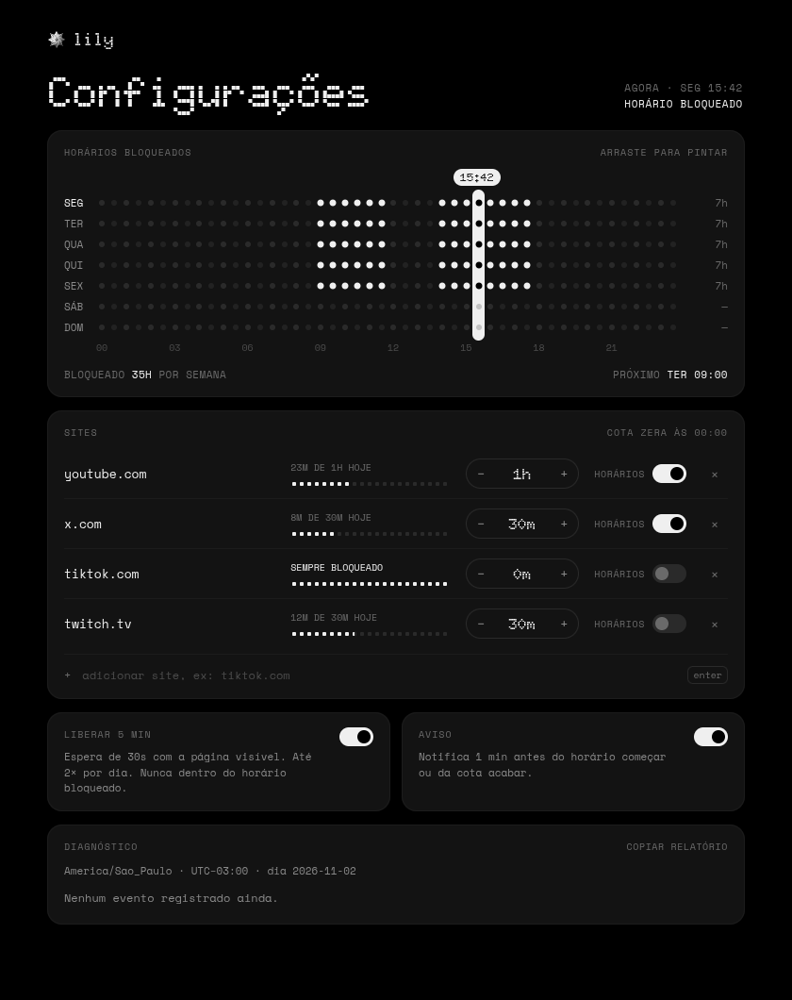
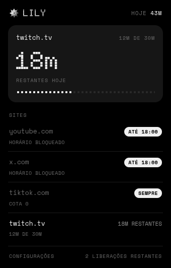

# Lily

Horários e cotas diárias para os sites que roubam seu tempo.

Extensão para Firefox e Zen, com interface em português, visual monocromático e dados guardados no próprio navegador. Feita com Svelte 5, TypeScript e WXT.

[Baixar a última versão](https://github.com/juicerq/lily/releases/latest) · [Regras e arquitetura](docs/spec.md) · [Licença MIT](LICENSE)



## Como funciona

Pinte os horários da semana em que quer evitar distrações e defina uma cota diária para cada site. Por exemplo: YouTube com 1h por dia e bloqueado das 14h às 18h. Às 15h, a Lily bloqueia o acesso mesmo que ainda sobre cota; fora desse horário, você usa o tempo restante até a cota acabar.

- **Grade semanal:** blocos de meia hora, editáveis com o mouse ou teclado.
- **Cotas por site:** zeram à meia-noite; cota 0 mantém o site sempre bloqueado, e sem cota ele segue apenas os horários.
- **Tempo de uso:** conta na aba ativa da janela em foco. Pausa após 60s sem interação, exceto com mídia tocando.
- **Liberação de 5 min:** espera de 30s com a página visível, até duas vezes por dia, fora dos horários bloqueados.
- **Avisos:** notificação 1 min antes do horário começar ou da cota acabar.

### Na barra do navegador

O popup mostra o tempo restante da aba atual e o estado dos outros sites.



### Quando é hora de parar

A tela de bloqueio explica o motivo e mostra quando o site estará disponível de novo.


As capturas usam a interface real da extensão com dados de exemplo.

## Instalar

### Zen

1. Baixe o arquivo `.xpi` em [Releases](https://github.com/juicerq/lily/releases/latest).
2. Em `about:config`, defina `xpinstall.signatures.required` como `false` para permitir o pacote sem assinatura.
3. Em `about:addons`, abra a engrenagem → **Instalar extensão de um arquivo** e escolha o `.xpi`.

Depois da primeira instalação, o navegador consulta o [`updates.json`](updates.json) para buscar novas versões publicadas neste repositório.

### Firefox

O manifest exige Firefox 140 ou mais novo. Para experimentar a build local, abra `about:debugging#/runtime/this-firefox`, clique em **Carregar extensão temporária** e selecione `.output/firefox-mv3/manifest.json` após executar `bun run build`. A instalação temporária dura até o navegador ser fechado.

## Privacidade

Configurações, contadores de uso e registro de diagnóstico ficam no armazenamento local do navegador. A extensão não envia esses dados a servidores, não usa analytics e inclui as fontes no pacote. O navegador consulta o GitHub para atualizar a versão instalada pelo `.xpi`.

As permissões permitem observar abas e navegações para contar uso e redirecionar sites bloqueados, detectar ociosidade, agendar bloqueios, guardar dados e exibir avisos. Detalhes do funcionamento estão na [especificação](docs/spec.md).

## Desenvolvimento

Requer [Bun](https://bun.sh) 1.4 ou mais novo e Firefox ou Zen.

```sh
bun install --frozen-lockfile
bun run dev
```

O modo de desenvolvimento abre um perfil temporário e recarrega a extensão a cada mudança. Para usar um binário específico, crie `web-ext.config.ts` na raiz (ignorado pelo git):

```ts
import { defineWebExtConfig } from "wxt";

export default defineWebExtConfig({
  binaries: { firefox: "/caminho/para/firefox-ou-zen" },
});
```

```sh
bun run check
bun run lint
bun run build
bun run xpi
```

A build fica em `.output/firefox-mv3`; o pacote instalável, em `.output/lily.xpi`. O GitHub Actions executa tipagem, lint e build em pushes e pull requests.

Veja [como publicar uma versão e enviar ao AMO](docs/releasing.md).

## Licença

Código sob a [licença MIT](LICENSE). As fontes Doto e Space Mono são distribuídas sob a SIL Open Font License; os respectivos textos estão em [`public/fonts`](public/fonts).
